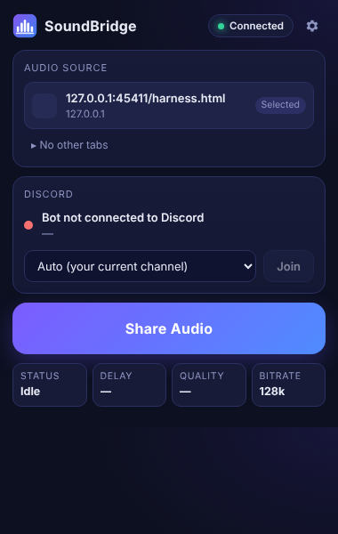

# SoundBridge

Share the audio of **one Chrome tab** (SoundCloud, YouTube, a podcast…) into a Discord
voice channel through a bot on your own server. Your game, Discord voice and other
apps are never captured.

```
Chrome tab → tabCapture → AudioWorklet → Opus (WebCodecs) → WSS → your VPS → Discord bot → voice channel
```

* Not a music bot: it never searches or downloads. It forwards what your tab plays,
  so pause, seek, next track and volume just follow the browser.
* Official bot account (no self-bot).
* Lightweight: ~100 MB RAM on the server and no transcoding (Opus packets are forwarded).
  Upload ≈ 17 KB/s.
* Secure: access token, extension-only origins, rate limits, HTTPS/WSS via Caddy,
  bot token stays on the server.



## Repository

```
extension/   Chrome MV3 extension (plain JS, no build step) — load unpacked
server/      Node.js 22 + TypeScript: Discord bot + WebSocket/HTTP ingest
shared/      Wire protocol (copied into the extension: npm run sync-protocol)
deploy/      Oracle/Ubuntu: inspect-server.sh, install.sh, systemd unit, Caddyfile
docs/        architecture, setup, deployment, testing, roadmap
scripts/     e2e browser test, icon generator, protocol sync
```

## Start here

1. [docs/setup.md](docs/setup.md) — run everything on your PC first
2. [docs/testing.md](docs/testing.md) — what to check
3. [docs/deployment.md](docs/deployment.md) — move the server to Oracle Cloud
4. [docs/architecture.md](docs/architecture.md) — how and why it works
5. Russian quick guide: [docs/QUICKSTART.ru.md](docs/QUICKSTART.ru.md)

## Commands

| | |
|---|---|
| `npm run dev` | server + bot with auto-reload |
| `npm run build && npm start` | production run |
| `npm run deploy-commands` | register slash commands |
| `npm test` | server test suite |
| `npm run e2e` | real-browser pipeline test (Playwright + ffmpeg) |
| `npm run gen-token` | random `ACCESS_TOKEN` |

Never commit `server/.env`.
